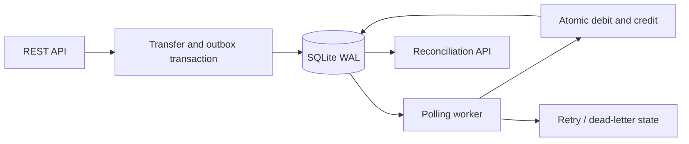

# LedgerFlow — Transaction and reconciliation engine

**Status:** runnable portfolio prototype; synthetic data only.

A simulated financial ledger with atomic double-entry posting, idempotent transfer submission, durable local outbox, background processing, bounded retries, dead-letter replay and reconciliation.

## Run locally
Requires Node.js 24 (Node 22.16 also tested). No npm dependencies.
```sh
npm test
npm start
curl -X POST http://localhost:8080/transfers -H 'Content-Type: application/json' -d '{"id":"transfer-1","src":"alice","dst":"bob","amount":100}'
curl 'http://localhost:8080/transfers?id=transfer-1'
curl 'http://localhost:8080/balance?id=alice'
curl http://localhost:8080/reconcile
curl http://localhost:8080/metrics
```
The three demo accounts start with 100,000 minor units each. Requests return 202; poll the transfer until completed or rejected. Reusing an ID with changed details returns 409. No money is moved.

## Architecture

A single SQL transaction serialises balance checks and both entries, preventing partial postings. The outbox and transfer are inserted atomically; the worker commits posting and completion atomically. Failure injection tests demonstrate rollback, retry and replay. Reconciliation checks entry count and net balance for each transfer.

## Trade-offs and next steps
This is a local single-database model, not distributed microservices. Retry uses a fixed one-second delay and five attempts, not exponential backoff. The worker processes an outbox table directly; RabbitMQ, gRPC, PostgreSQL, multi-service sagas, authentication, external settlement reconciliation, and Kubernetes are future work. Dead-letter replay is an unauthenticated local demo endpoint. Never expose this application publicly or use it for actual financial transactions. For a distributed version, add a publisher with confirms, idempotent consumer inboxes and independently tested recovery semantics.

## Docker
```sh
docker compose up --build
```
Each project uses port 8080; run separately or change the host port in compose.yaml. Docker configuration is supplied but was not executed in the authoring environment.

## Reproducible benchmark
```sh
npm run bench
```
Measured once in the authoring Linux container; not production throughput or a network load test.
```json
{
  "scope": "single process in-memory SQLite submit and process",
  "transfers": 5000,
  "perSecond": 992,
  "discrepancies": 0
}
```

## Repository guide
Source code, automated tests, benchmark scripts, Docker configuration and a GitHub Actions workflow are included. Review the design and run the tests before presenting this as your own portfolio work.
>>>>>>> 50431ac (Modified test)
